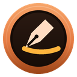

<p align="center"></p>

# Overmark

[](https://github.com/Suremise/overmark/actions/workflows/ci.yml)
[](LICENSE)

**Draw over your screen, then capture it.**


Press a hotkey and a transparent layer covers the screen. Draw on it with a pen or a
highlighter, then keep explaining (on a call, with the screen still moving underneath) or capture
what you see with your drawing on it, to the clipboard and a file in one go. It replaces the
"screenshot, save, open, annotate, save again" loop with one gesture.

Overmark is free and open source (MIT), for Windows 10 and 11.

> **Status:** version 0.1.0, the first release, is out. Download it from
> [Releases](https://github.com/Suremise/overmark/releases) ([Installing](#installing), below), or
> [build it from source](#building-from-source).

## Two modes over one drawing

- **Live:** the screen keeps playing underneath. Draw over it to explain something on a call;
  there's nothing to save.
- **Frozen:** the screen is held still underneath, as a screenshot is, so you can mark up an
  exact moment and capture it.

Switch between them at any time with **F**, before or after you've drawn: your strokes stay. Or
open straight into Frozen with its own hotkey. **W** also takes you to a **whiteboard** or a
**blackboard**, and **G** lays a **grid, dots or ruled lines** under the ink.

While the layer is open it takes the mouse and pen, the screen is dimmed slightly so you can see
it's open, and a small toolbar shows the mode and how to leave. The toolbar and the dim are hidden
from screen sharing, so people on a call see your drawing but not the toolbar. **Esc** closes the
layer, and the drawing goes with it: each time starts clean.

## At a glance

| Keys | What they do |
|---|---|
| **Win+Shift+D** | Draw (Live) |
| **Win+Shift+F** | Draw on a frozen screen |
| **F** | Freeze or unfreeze |
| **W**, **Shift+W** | The next or previous backdrop: Live, Frozen, whiteboard, blackboard |
| **G**, **Shift+G** | The next or previous guides: none, grid, dots, ruled lines |
| **Ctrl+S** | Save the screen the pointer is on, with the drawing |
| **Ctrl+Shift+S** | Save a region |
| **Ctrl+C** | Copy instead of saving |
| **Ctrl+Shift+Alt+S** | Save without the drawing |
| **Ctrl+Z**, **Ctrl+Y** or **Ctrl+Shift+Z** | Undo and redo (at least 100 steps) |
| **Delete** | Clear the drawing (Ctrl+Z brings it back) |
| **1**–**9** | Pick a colour from the palette |
| **Esc** | Close the layer |

The hotkeys can be changed in Settings. Overmark never uses a keyboard or mouse hook: global
hotkeys go through Windows' `RegisterHotKey` only.

| Tool | Key | |
|---|---|---|
| Pen | P | Smooth, with pen pressure; with a mouse, speed sets the width |
| Highlighter | H | Tints without covering text |
| Arrow | A | The head grows with the width |
| Rectangle, Ellipse | R, E | Hold Shift for a square or circle |
| Line | L | Hold Shift to snap to 45° |
| Text | T | Click and type; Shift+Enter adds a line |
| Numbered stamps | N | 1, 2, 3… for steps in a bug report |
| Blur | B | On a frozen screen: hides secrets before you share |
| Eraser | X | Erases whole strokes |
| Laser pointer | Z | A glowing dot that leaves nothing behind |

**Capturing** copies to the clipboard and saves a PNG, by default to `Pictures\Overmark` with a
name like `2026-10-21 09.42.17.png`; Settings changes the folder, the name, the format (PNG or
JPG) and whether it copies, saves or both. **Disappearing ink**, for calls, fades strokes a few
seconds after you draw them.

**The [user guide](docs/user-guide.md)** covers everything: every tool and key, capturing, the
toolbar, the tray and Settings, portable or installed, Print Screen, and what to do when
something doesn't work.

## Privacy

**No telemetry, ever.** Overmark sends nothing anywhere and has no account. **It needs no network
access by default:** "Check for updates" is off by default, and when you turn it on it only reads
the latest release on GitHub; it never downloads or installs anything by itself. Captures stay
where you save them, and nothing is ever uploaded.

## Installing

Each release on GitHub has two downloads and `SHA256SUMS.txt`:

- **The MSI** (`overmark-<version>-x64.msi`). By default it installs **per user, with no admin
  rights**, to `%LOCALAPPDATA%\Programs\Overmark`, with a Start menu shortcut and an uninstaller.
  Settings are kept in `%APPDATA%\Overmark\settings.toml`. **For IT** (Intune, SCCM), the same MSI
  installs **per machine**, silently:

  ```
  msiexec /i overmark-<version>-x64.msi ALLUSERS=1 /qn
  ```

  Add `STARTWITHWINDOWS=1` to either install to start Overmark when you sign in (for every user,
  per machine). [docs/RELEASING.md](docs/RELEASING.md) has the details.

- **The portable zip** (`overmark-<version>-portable.zip`): `overmark.exe` and an empty file named
  `portable`. Unzip it anywhere, such as a USB stick, and run `overmark.exe`: with the `portable`
  marker (or a `settings.toml`) beside it, Overmark keeps everything in that folder and writes
  nothing to the registry, unless you tick **Start with Windows**. Add a `portable` file beside any
  copy of `overmark.exe` to make it portable. If the folder can't be written to, Overmark says so
  and keeps its settings in memory, rather than writing anywhere else.

### SmartScreen and checksums

Overmark isn't code-signed yet, so Windows SmartScreen may warn the first time you run the
installer or the exe ("Windows protected your PC"). Check the download first: compare its SHA-256
with the one in the release's `SHA256SUMS.txt`, in PowerShell

```
Get-FileHash .\overmark-<version>-x64.msi -Algorithm SHA256
```

or, with `SHA256SUMS.txt` beside the downloads, in Git Bash or WSL

```
sha256sum -c SHA256SUMS.txt --ignore-missing
```

and if they match, choose **More info**, then **Run anyway**.

## Licence

**MIT, and every dependency is MIT or equally permissive;\* system fonts only.**

Overmark's own code is under the [MIT licence](LICENSE). Every Rust crate it's built from is MIT,
Apache-2.0, BSD, ISC, Zlib or similarly permissive, and CI checks that with `cargo deny`. Its
stroke engine is a port of [perfect-freehand](https://github.com/steveruizok/perfect-freehand)
(MIT). It bundles no fonts: text uses Windows' own. Every licence is in
[THIRD-PARTY-NOTICES](THIRD-PARTY-NOTICES.txt), which ships with Overmark.

\* One exception, decided on purpose: **Microsoft's C runtime** is linked into `overmark.exe`,
unmodified, under Microsoft's redistribution terms ("Distributable Code"). Every Windows app
built with Microsoft's compiler carries or needs it; linking it in means Overmark installs and
runs without an admin install of the Visual C++ redistributable.

© 2026 Darren Marshall. Overmark is independently developed and isn't affiliated with, endorsed
or sponsored by Microsoft. Microsoft and Windows are trademarks of the Microsoft group of
companies.

## Building from source

You need Windows 10 or 11, [Rust](https://rustup.rs) (the toolchain is pinned in
`rust-toolchain.toml`; rustup installs it on first use), and Visual Studio's C++ build tools with
the Windows SDK.

```
git clone https://github.com/Suremise/overmark
cd overmark
cargo build --release
```

The exe is `target\release\overmark.exe`: one file, with its strings built in.

`cargo nextest run --workspace` (or `cargo test --workspace`) runs the tests.
[CONTRIBUTING.md](CONTRIBUTING.md) has the rest: the checks, the code layout, the golden images
and how to add a string or a language. [docs/ARCHITECTURE.md](docs/ARCHITECTURE.md) explains how
it's built and why.

## Contributing and security

- Contributions are welcome: see [CONTRIBUTING.md](CONTRIBUTING.md) and the
  [Code of Conduct](CODE_OF_CONDUCT.md).
- Found a security problem? Please report it privately, as [SECURITY.md](SECURITY.md) says, not in
  a public issue.
- What's changed: [CHANGELOG.md](CHANGELOG.md).

Overmark is on GitHub at [github.com/Suremise/overmark](https://github.com/Suremise/overmark). Its
home page is [surmise.it/tools/overmark](https://surmise.it/tools/overmark/).
